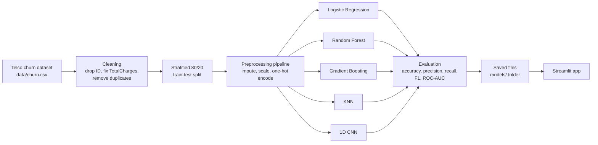
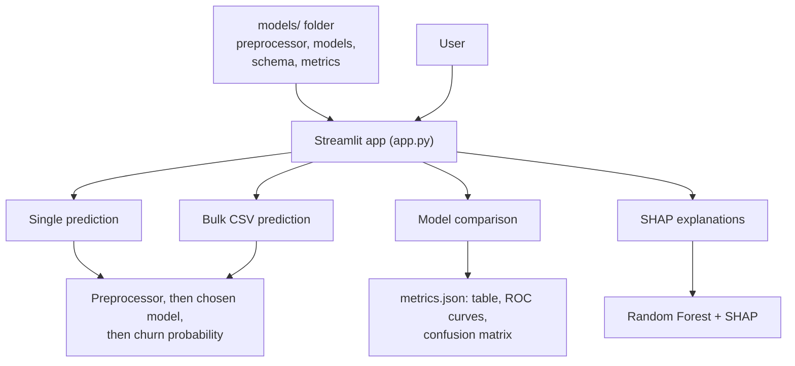
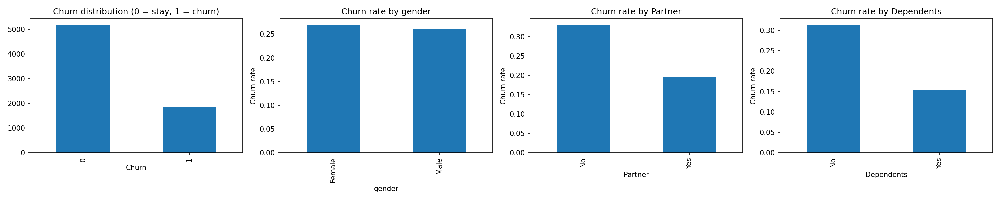
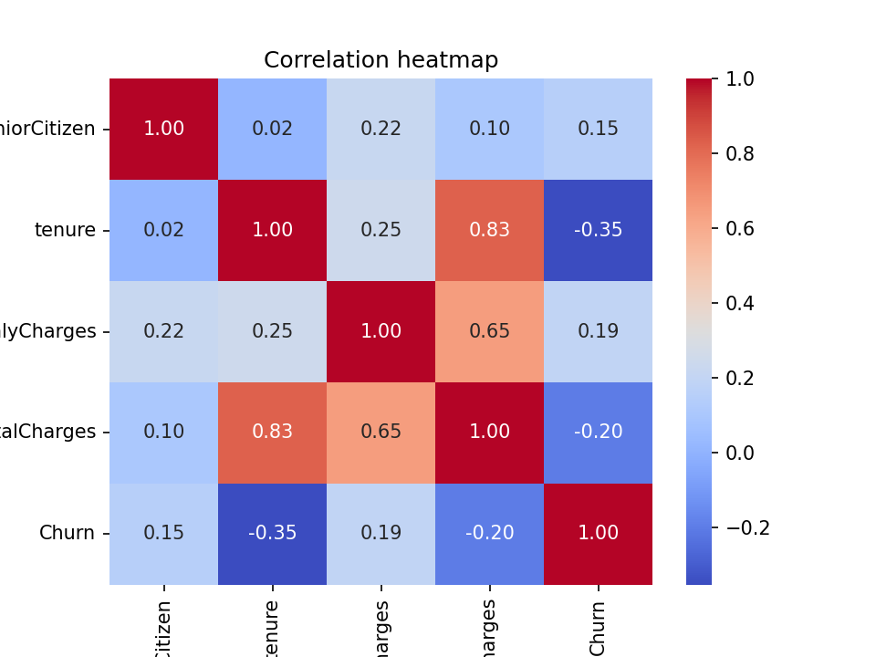
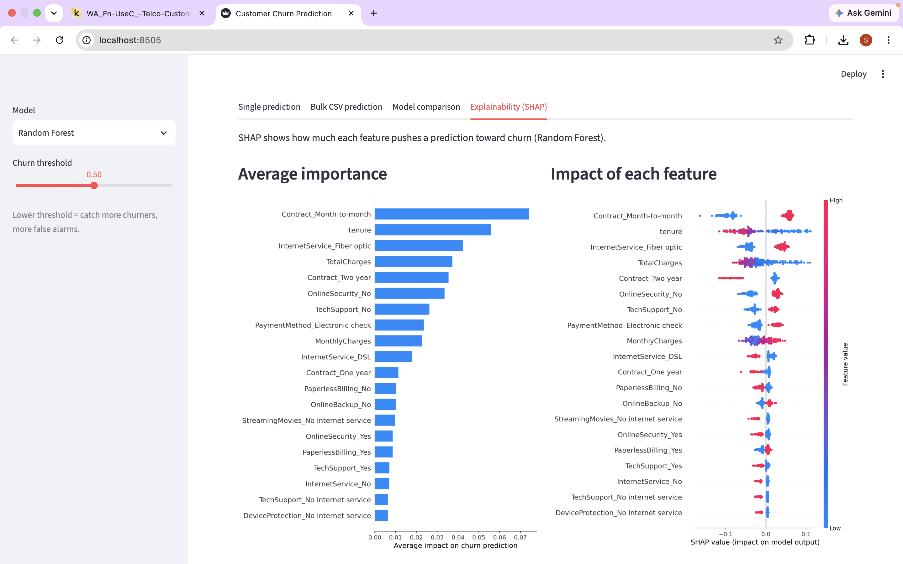

# Customer Churn Prediction

An end-to-end machine learning project that predicts which telecom customers are likely to leave, with an interactive Streamlit app for live predictions, bulk CSV scoring, model comparison and SHAP explanations.

## What's the use?

Telecom, streaming and other subscription companies lose money every time a customer leaves, and winning a new customer usually costs more than keeping an existing one. This project flags customers who are likely to leave, so a company can contact them early with an offer or better support. The explanations show *why* a customer is at risk (for example, a short tenure on a month-to-month contract), so the team knows what to fix instead of guessing.

## Features

- **Traditional ML models:** Logistic Regression, Random Forest, Gradient Boosting and KNN
- **1D CNN** (deep learning) trained on the preprocessed customer features
- **Explainable AI with SHAP:** see which features push a customer toward churn
- **Bulk CSV prediction:** upload a file of customers and download churn probabilities and risk levels
- **Interactive model comparison dashboard:** metrics table, bar chart, ROC curves and confusion matrix
- **Streamlit web app:** one app with four tabs

## Dataset

Telco Customer Churn dataset (Kaggle), with 7,043 customers and 19 features such as tenure, contract type, monthly charges and services subscribed. The target is `Churn` (Yes/No). About 26.5% of customers churned, so the data is imbalanced.

## Architecture

### Full project pipeline



### Streamlit web app



The CNN is trained with the Adam optimiser, binary cross-entropy loss, class weights for the imbalance, and early stopping on validation AUC.

## Approach

1. Exploratory data analysis (churn distribution, churn rate by group, correlations)
2. Cleaning: removed the ID column, converted `TotalCharges` to numbers, handled missing values and duplicates
3. Stratified 80/20 train/test split, with all scaling and encoding fitted on the training set only to avoid data leakage
4. Preprocessing pipeline: median imputation and scaling for numeric columns, one-hot encoding for categorical columns
5. Trained four traditional models and a 1D CNN, with class weights to handle the imbalance
6. Evaluated on the held-out test set with accuracy, precision, recall, F1 and ROC-AUC, plus 5-fold cross-validated ROC-AUC for the traditional models
7. Added SHAP explanations and a Streamlit app

## Results

Test set metrics at a 0.5 threshold:

| Model | Accuracy | Precision | Recall | F1 | ROC-AUC | CV ROC-AUC |
|---|---|---|---|---|---|---|
| Logistic Regression | 0.740 | 0.506 | 0.777 | 0.613 | 0.840 | 0.846 |
| Random Forest | 0.770 | 0.551 | 0.715 | 0.622 | 0.840 | 0.846 |
| Gradient Boosting | 0.801 | 0.663 | 0.508 | 0.575 | 0.838 | 0.848 |
| KNN | 0.785 | 0.605 | 0.540 | 0.571 | 0.818 | 0.823 |
| 1D CNN | 0.744 | 0.511 | 0.723 | 0.599 | 0.829 | - |

**How to read this:** always predicting "stay" would already give about 73.5% accuracy, so ROC-AUC and recall matter more than accuracy here. The models score similarly on ROC-AUC (about 0.82 to 0.84). 

Logistic Regression catches the most churners (highest recall), while Gradient Boosting has the highest accuracy and precision. The 1D CNN lands in the same range (ROC-AUC 0.829) without beating the simpler models, which is common on a small table of customer data like this one. 
The decision threshold can be changed in the app to trade off missed churners against false alarms.

## Key insights


*Churn is lower for customers with a partner or dependents, and gender makes almost no difference.*


*Tenure has the strongest negative correlation with churn (-0.35): longer-tenure customers are less likely to leave, while higher monthly charges (0.19) slightly increase the risk of churn.*


*SHAP shows month-to-month contracts, short tenure and fibre-optic internet pushing predictions toward churn, while two-year contracts push toward staying.*
<br><br>
## Project structure

```
app.py              Streamlit app (prediction, bulk CSV, comparison, SHAP)
train.py            Trains and evaluates all models, saves files to models/
requirements.txt    Python dependencies
data/churn.csv      Telco Customer Churn dataset
models/             Saved preprocessor, models, schema and metrics
sample_bulk.csv     Example file for the bulk prediction tab
images              App screenshots used in this README
vid/notebooks.ipynb Exploratory analysis and training notebook
```

## Run locally

```bash
git clone https://github.com/<your-username>/<your-repo>.git
cd <your-repo>
pip install -r requirements.txt
python train.py          # optional: retrain (models/ is already included)
streamlit run app.py
```

Then open http://localhost:8501. Installing TensorFlow can take a few minutes.

## Bulk prediction

In the **Bulk CSV prediction** tab, upload a CSV of customers (same columns as the dataset, for example `sample_bulk.csv`). The app returns each customer's churn probability and risk level, and you can download the results.
<br><br>

<br><br>

## Limitations and future work

- The dataset is imbalanced, so accuracy alone is misleading. Recall and ROC-AUC are reported as well.
- Models use default or lightly tuned settings. Hyperparameter tuning and threshold optimisation could improve recall.
- SHAP explanations are computed for the Random Forest model.

## Tech stack

Python, pandas, NumPy, scikit-learn, TensorFlow/Keras, SHAP, Matplotlib, Seaborn, Streamlit
